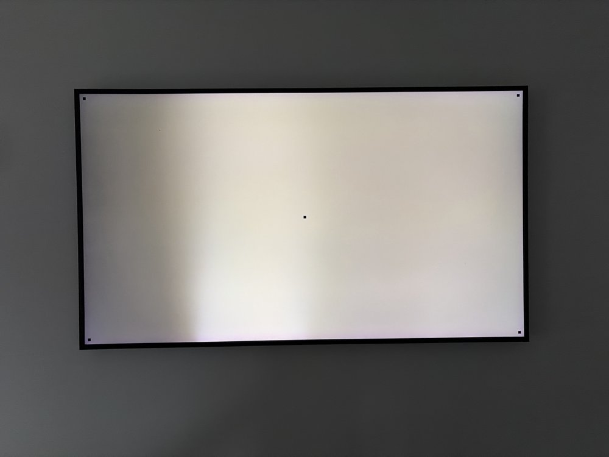
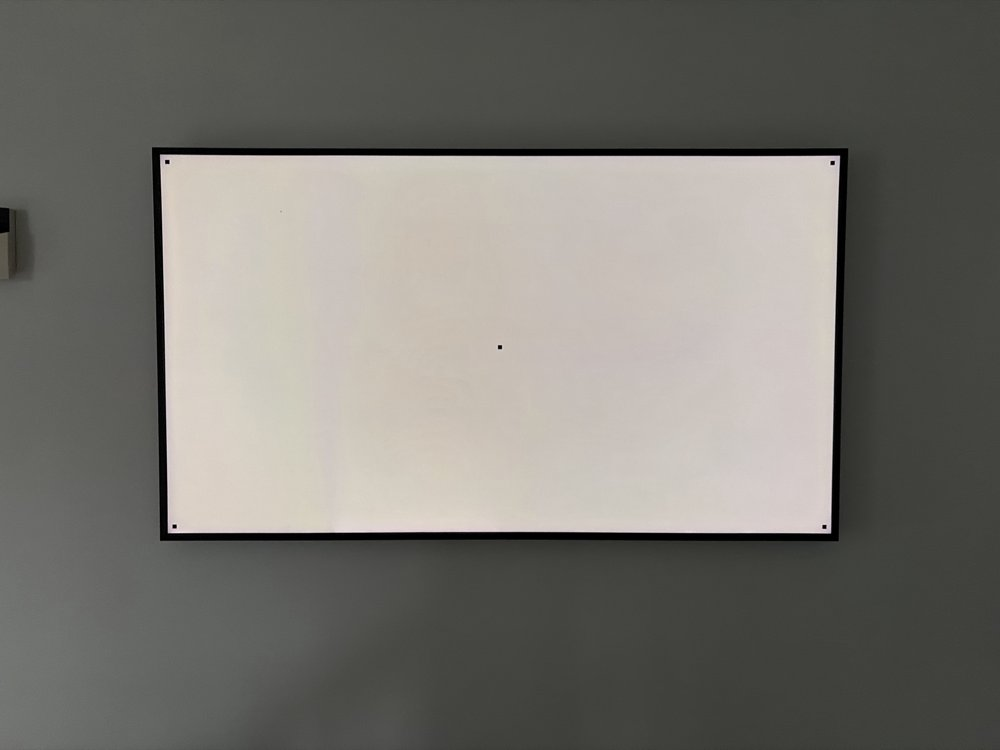

# samsung-tv-art

A command-line tool that manages the art on a Samsung The Frame TV over the local network. It uses the Art Mode channel of the TV WebSocket API through the [samsungtvws](https://github.com/xchwarze/samsung-tv-ws-api) library.

## Setup

Turn on the TV, then run these commands on a computer on the same network:

```bash
uv sync
uv run frame discover
uv run frame info
```

`frame discover` searches the local network for a The Frame TV. It saves the IP address and MAC address of the TV to `~/.config/frame-art/config.json`. If it finds more than one TV, or none, give the IP address yourself:

```bash
uv run frame --host 192.168.1.50 discover
```

The `--host` option and the `FRAME_HOST` and `FRAME_MAC` environment variables override the saved configuration. If the TV gets a new IP address, run `frame discover` again. To keep the same address, give the TV a DHCP reservation on your router.

## Commands

```bash
uv run frame discover                      # find the TV and save it
uv run frame info                          # art mode, current image, slideshow
uv run frame list                          # all images on the TV
uv run frame list --category MY-C0002      # your uploaded photos only
uv run frame upload photo.jpg --show       # upload and show at once
uv run frame show MY_F0001                 # show an image by content id
uv run frame mattes                        # matte types and colours
uv run frame matte MY_F0001 modern_navy    # change the matte of an image
uv run frame slideshow 15                  # new image every 15 minutes
uv run frame slideshow 0                   # stop the slideshow
uv run frame delete MY_F0001               # delete an uploaded image
uv run frame artmode on
uv run frame wake                          # Wake-on-LAN
```

## Categories

| Category   | Content                  |
|------------|--------------------------|
| `MY-C0002` | Your uploaded photos     |
| `MY-C0004` | Favourites               |
| `MY-C0008` | Art Store                |

## TV configuration

The TV must be on, or in Art Mode, to answer. If the TV is fully off, its Wi-Fi sleeps. Turn on these settings on the TV:

```
Settings > General > Network > Expert Settings > Power On with Mobile = On
Settings > General > External Device Manager > Device Connection Manager > Access Notification = First Time Only
```

The Art Mode channel on this TV firmware does not ask for pairing. If the TV shows an "Allow" prompt, select "Allow" with the remote. The tool keeps the pairing token in `~/.config/frame-art/token`.

## Images

The screen is 3840x2160. `frame upload` converts every image that is not an RGB JPG, such as WebP or PNG, to JPG. The TV drops the connection on large PNG files with transparency. It scales images smaller than the screen up to fit, which makes them soft, so use 3840x2160 sources when you can.

## Screen fade correction

If parts of the panel are darker than others, `frame upload --correct` multiplies each image by a correction mask before upload. The mask dims the bright areas of the screen to match the faded areas, so the picture looks even but darker.

### Example

The photos below show a TV with a faded left edge and darker bands on the right. The first photo shows a plain white screen. The second photo shows the same screen with the calibrated mask, after four photos.

| Before | After |
|--------|-------|
|  |  |

This is the mask for that TV, scaled up. Light areas keep their brightness, and dark areas are dimmed to match the faded areas:


The mask file is [`docs/sample-mask.png`](docs/sample-mask.png). It is 192x108 pixels, and the tool stretches it to the screen. It applies only to that TV, so make your own mask for your TV.

### Calibrate the mask

You make the mask from phone photos of a test card. The card is a white screen with a small black square near each corner and one in the centre.

1. Run `uv run frame calibrate start`. The TV shows the test card.
2. Make the room dark. Take a photo of the whole screen, straight on, with all four corner squares in view.
3. Run `uv run frame calibrate photo <photo.jpg>`. The tool measures the fade, refines the mask, and shows a corrected test card.
4. Take another photo from the same place, and run step 3 again. Repeat until the screen looks even. Three or four photos are usually enough.
5. Run `uv run frame calibrate finish` to remove the test card.

The command prints how much darker the dim areas are than the bright areas. If your phone has a manual or pro mode, lock the exposure, because automatic exposure hides part of the fade. The phone lens also darkens or brightens the edges of a photo a little, so a few percent of unevenness can remain.

`frame calibrate start` continues from the saved mask. To start again from no correction, run `uv run frame calibrate start --reset`.

### Upload with the mask

```bash
uv run frame upload photo.jpg --correct --show
uv run frame upload photo.jpg --correct --strength 0.6 --show
```

The mask is an RGB image at `~/.config/frame-art/correction.png`, where 255 is no change. The tool stretches it to the full screen. Use `--mask` to give a different file.

To use a mask on another computer, copy the mask file into the configuration directory of that computer:

```bash
mkdir -p ~/.config/frame-art
cp docs/sample-mask.png ~/.config/frame-art/correction.png
``` A `--strength` below 1 removes less of the fade but keeps more brightness. With `--correct`, the tool places images that are not 16:9 on a black 3840x2160 canvas, so the mask lines up with the panel.
